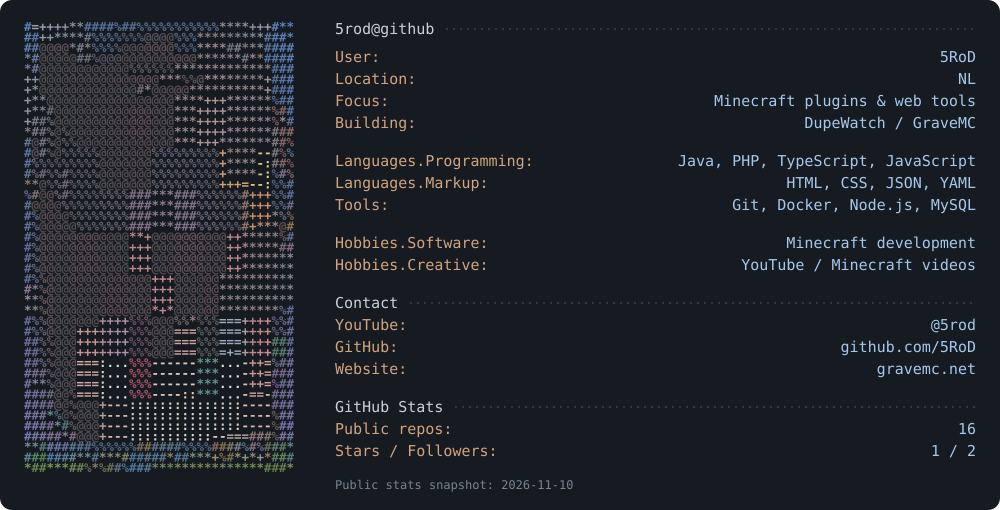

<p align="center">
  
</p>

<p align="center">
  <a href="https://www.youtube.com/@5rod">YouTube</a> ·
  <a href="https://gravemc.net">GraveMC</a> ·
  <a href="https://discord.gg/z6WgSZTyDU">Discord</a> ·
  <a href="https://instagram.com/5rodx">Instagram</a>
</p>

<details>
<summary>Plain-text profile</summary>

```text
5rod@github
Name: 5RoD
Location: NL
Focus: Minecraft plugins & web tools
Building: DupeWatch / GraveMC
Languages: Java, PHP, TypeScript, JavaScript
Markup: HTML, CSS, JSON, YAML
Tools: Git, Docker, Node.js, MySQL
YouTube: https://www.youtube.com/@5rod
GitHub: https://github.com/5RoD
Website: https://gravemc.net
```

The artwork uses my YouTube channel avatar, not a real photo.
GitHub counts are a public-data snapshot dated 2026-11-10, not live totals.

</details>
